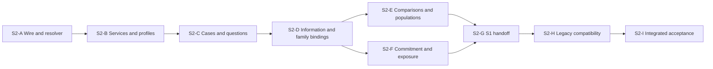

# Subsystem 2: final design review candidate and implementation gates

Tickets: DLV-08, DLV-09; related DLV-10, DLV-06/07 and ADV-01.
Date: 2 Nov 2026, America/Los_Angeles.
Status: prepared for Uzair's final S2 design review. Not a recorded acceptance,
implemented support, public protocol adoption, preregistration or build go.

Read [closure decisions Z01-Z24](subsystem2-contract-closure-2026-11-02.md), the
[exact catalog](subsystem2-contract-catalog-2026-11-02.json),
[specimen inventory](subsystem2-specimens-2026-11-02/manifest.json),
[negative specifications](subsystem2-specimens-2026-11-02/negative-cases.json),
[API scenarios](subsystem2-specimens-2026-11-02/api-scenarios.json), and the
[implementation DAG](subsystem2-implementation-dag-2026-11-02.json).
The [traceability index](subsystem2-review-traceability-2026-11-02.json) maps the
92 source obligations, 18 capability axes, 28 capability cases, all adverse/API
specifications and B01-B12 interface gates to responsibilities/future bundles.
These are design mappings, not native or measured scientific coverage.
Earlier sources remain linked by the [design rebase](subsystem2-design-rebase-2026-11-02.md).

## 1. Outcome of this design pass

The proposal is one generic scientific experiment layer over S1 evidence, with
independently selected semantic families and five scoped profiles. It separates
fixed requirements, later input resolutions, native evidence and analysis bindings.
The core has no native invocation, scientific scoring, paid API or protected-store
authority. Native adapters translate evidenced representations; reusable semantic
and binding rules belong in the core, with exact versions and explicit limits.

The bounded pass produced:

- 40 core payload kinds, with exact closed supporting shapes and references.
- 25 exact parameter schemas and 11 structured payload formats.
- 16 metadata entry points, explicit injected services and S1/legacy ownership.
- 38 synthetic packages, including 543 S2 records, covering all 40 core kinds;
  S1 records remain in their own packages. Counts are document inventory, not trials.
- 146 logical-source responsibility mappings (76 original plus 70 extension
  records), with source-account retention distinguished from typed interpretation.
- 58 adverse-case specifications and 20 API scenarios covering all 16 entry points.
- A nine-bundle implementation DAG; every bundle remains pending a build go.

No finite specimen set proves absence of every possible incompatibility. Within
these cases, the detected representation/interface incompatibilities have recorded
resolutions. Unsupported scientific/native combinations have an explicit behavior:
preserve evidence and withhold the affected interpretation/binding/profile.
That is part of the contract, not an invitation to fabricate the missing meaning.

## 2. A-H recomposition review

| Example | What is represented explicitly | What remains withheld or external |
|---|---|---|
| A: static label contrast | Fixed source/domain/reference; separate condition labels, task/response/cardinality, six trial slots, later case/member/resolution, surviving stage versus final/abstention, six-entry quality population | Actual 1000-row source bytes, native support/attempt/lifecycle and condition-conformance observations are not supplied. Five starts and other story facts remain labeled source accounts. The two included quality entries illustrate the rule, not real scoreability |
| B: historical reconstruction | Prior recovered artifact declarations; contested assert/deny references; retrospective task/comparison; current case and import/evaluation receipt; original history/mapping gaps | No invented native trial, run binding, request or attempt. No fresh-input requirement for retrospective evaluation. Original sampling, mapping, omission, producer and preregistration remain unknown; no exact accuracy claim |
| C: adaptive local query | Bounded two-action rule; typed 0.25 mean summary for X=0; explicit selected Y=1 action and evidence input; partial exposure and no final answer | Selected second action is not delivery. No original private reference, real admission/grant, reset, read-consumption or parent-accuracy claim. Failure does not reset exposure |
| D: overlapping temporal windows | Two planned window slots, two realized case/member identities, overlap relation, explicit index/unit/lag/window eligibility payload and two intended population units | Source/epoch/stationarity/native time decoding still require evidence. No iid or unseen-participant claim. Boundary queries outside eligibility are not absent causes |
| E: relational/distributed | Employee perspective/path and site-qualified identity requirements; two party contribution requirements; aggregation/access/missing-party fields | No central raw rows, site-B completion, global CI or linkage of equal local IDs. Actual party permissions, joins, overlap and supported aggregation stay explicit prerequisites |
| F: learned domains | Separate encoder-domain identities, four candidate mappings (two per encoder), set-valued alignment, fixed calibration procedure and candidate selection rule | No identity from factor index, uniform candidate probabilities or best-score mapping. Actual fitting/calibration/identifiability and source-aligned scoreability remain unestablished |
| G: weighted outputs | Four native member identities, g1/g2 equal graph content with distinct parameter associations, unnormalized masses 2/1/1/2 and a separate collection | Theta payloads are missing declarations, not interpreted parameters. Native posterior validity/calibration is not proved. Probability derivation requires positive finite mass and declared event. Marginal thresholding can violate DAG constraints |
| H: environments/proxy | Known-empty e0 targets, known Y intervention in e1, explicitly unknown e2 targets; distinct baseline/active references; separate proxy domain and measurement rule | No zero mask for unknown targets, baseline/active reference substitution, do(Y)=do(Y_star), universal proxy truth inheritance or known-target-only native readiness |

The wire packages are complete envelope/payload/reference instances for their
declared bounded scope. They are intentionally incomplete scientific evidence.
Raw design-account snapshots preserve the original discussion; they are not typed
scientific facts simply because their bytes are captured. No raw source-account
blob satisfies a family interpretation prerequisite.

The dedicated bridge examples exercise an unready M input binding, an R request
preview, an H association receipt and a later amended P2 plan. They do not claim
a real runnable projection, dispatch, loaded state or compliant admission. The
earlier P remains immutable; old trials retain their original-plan relation.

## 3. Checks actually run, and their limits

Receipt: `../_w2_checks/2026-11-02_s2_contract_closure/specimen-consistency.json`.
The one-off documentation checker lives outside the repo alongside that receipt.
It is not an S2 package module or reusable production validator.

The current receipt checks closed record shapes against the candidate catalog and
inspected S1 declarations; parameter keys/roles/types/enums; all 11 structured
payload shapes and their qualified references; actual snapshot byte pins and S2
publication encoding; local/external target kinds; package dependency acyclicity;
definition-package closure excluding later trace bytes; distinct commitment subject
bytes; all 40 core-kind coverage; logical-source mapping inventory; negative target
paths/IDs and API entry-point inventory; and the bounded analytic facts below.

Illustrative arithmetic: temporal index overlap is {3,4,5}, unique time points 9,
eligible child overlap {4,5}. G's literal mass total is 6; adjacency mass 4/6=2/3,
directed mass 3/6=1/2, conditional orientation 3/4. The three-member DAG construction
can yield a cyclic threshold graph. C's 0.25 selects the nonnegative branch.
These are consistency checks on literals, not native scientific measurements.

The 58 negative specifications and 20 API scenarios have not been run against an
implemented S2 library. Their IDs/targets/inventory were checked; future bundles
must turn each into meaningful executable acceptance cases. The S1 product validator
was not rerun: this interpreter lacks jsonschema. S1 shapes were inspected by AST
for the documentation checks; its previous release evidence remains separate.
This dependency does not block documentation, but must be restored/verified in
the approved build environment before future runtime gates can claim a pass.

Earlier failed check receipts are retained outside the repo. A missing
ScopedKey case in the one-off checker was corrected; uppercase generated site-rule
names were corrected to the existing QName grammar. The design fixes are Z01-Z24;
these checker/authoring corrections are not passed product regression tests.

## 4. Required before a build begins

1. Uzair accepts the bounded design and explicitly authorizes implementation.
   Continuing this design discussion has not itself done either.
2. Record hashes for the accepted catalog, notes, manifest/specimens and DAG as the
   build baseline. Changes uncovered during implementation receive a new decision
   entry and affected tests; do not silently edit an accepted historical contract.
3. Re-establish original/S1 code identity and current interpreter/dependencies,
   baseline suite and stored rerun/certificate expectations. Diagnose differences
   to source lines before accepting a changed baseline. No installs/native imports
   from untrusted manifests; dependencies are an explicit environment step.
4. Check the DAG and required predecessor receipts. Failed or skipped required
   gates do not unlock descendants. No real sealed store/ledger is read to prepare
   a gate; tests use explicit synthetic fixtures and temporary roots.

## 5. Nine proposed implementation bundles

| Bundle | Purpose and predecessors | Main acceptance evidence |
|---|---|---|
| S2-A | Strict catalog/primitives/codec and bounded offline resolver; none | All record/parameter/payload shapes, exact versions, strict bytes, unknown handling, digest/reference conflicts and limits; no implicit retrieval |
| S2-B | Transactional writers, exact registries and scoped profiles; A | Rollback/idempotence, correct producer identity, no automatic handler loading, explicit false/unknown/no-reader assessments and independent profiles |
| S2-C | Cases, slots, releases, tasks, response/reference bindings; B | Static and retrospective compositions; membership multiplicity; omission/abstention/alternatives; contested/missing references; no historical native run invention |
| S2-D | Information, transformations, randomization and family binding checks; C | Temporal, relational/distributed, learned, weighted and environment/proxy boundaries; late materialization receipts; native/evaluator separation; no transforms or fits executed |
| S2-E | Comparison/repetition and analysis-population binding; D | Intended/missing/unmatched units, explicit selections/cardinality/weights/dependence, independent scientific repetition versus retry, conditional quality versus utility; no metric implementation |
| S2-F | Commitments, amendments, adaptive decisions and exposure accounting; D | Earlier byte pins, future-dependency rejection, selected versus delivered actions, original-history limits, synthetic partial exposure; no grants or protected-store reads |
| S2-G | S1 projection/handoff and immutable publication wrapper; E,F | Exact supported projection and explicit S1 contexts; unknown native support blocks projection; stable R/O record content under distinct package IDs; correct provenance; no invoke/dispatch |
| S2-H | Legacy import and explicit compatibility views; G | Source-backed echo, reported versus observed hash, n/status/replicates meaning, lossless rejection for repeated/richer outputs and explicit lossy selection; no old-route replacement |
| S2-I | Integrated opt-in interface, acceptance bank and release support statement; H | All A-H/bridge/API/adverse cases, recorded system end to end, dependency/skip accounting, source stability, exact supported-scope matrix and retained known gaps |

The [DAG JSON](subsystem2-implementation-dag-2026-11-02.json) is authoritative for
proposed bundle dependencies, must-show lists, artifacts, blocking conditions and
common preservation gates. These bundle IDs are planning labels, not new tracker
tickets. Each advances existing DLV-08/09 and evidence for DLV-10; only W5 changes
ticket state/adoption. No bundle is marked built or accepted here.

Every bundle must additionally show an actual stored audit end to end, current
appropriate tests, 1,298 stored comparisons within 0.001 with exact key/count/verdict
parity, and all 14 stored certificates verifying. Later release checks also verify
fresh certificates at their applicable existing tolerance. No tolerance widening.
The original source set and approved S1 implementation identity remain stable unless
a separately reviewed, authorized dependency change is necessary. Explain every
skip; an unavailable required dependency leaves that gate incomplete.

Use an opt-in new namespace, proposed `audit/experiments/`; a new optional module
CLI can inspect/validate/import/project metadata. It has no run/spend/sealed-read
command. Existing audit routes, adapters, measurement logic, findings, results,
certificate versions and paper pointers stay owner-controlled. Tests and receipts
write outside the repo. Shared/pinned changes require their existing guarded-patch
workflow and relevant owner authorization; the plan supplies none implicitly.

## 6. Residual prerequisites and scientific claim boundary

Resolved representation is not implemented capability. In particular:

- S3 must supply actual native execution/recovery, runtime authority and production
  controlled-release/consumption integration. Real legacy read limits are unchanged.
- S4 must provide applicable metrics/statistical procedures. S2 binds their exact
  identities and populations; it does not compute new scores or infer identifiability.
- Native operations/readers/configurations need exact per-mode support evidence.
  The capability map's broader systems and all cross-products are not validated by
  these examples. Unrecognized families can be preserved, with stronger claims withheld.
- W5 adopts protocol changes; W1/W5 arrange durable paper-source pointers and locks.
  Funding remains pending; no paid-run authorization follows from this plan.

These are declared ownership/evidence prerequisites with defined unsupported
behavior, not structural gaps to paper over with a convenient field/default.
When runtime tests expose a new incompatibility, extend the decision log and gate;
never claim this finite review ruled out everything in the wider capability space.

## Where we're going

Review the candidate as one coherent subsystem: generic core, faithful native
evidence, explicit unknowns and incremental acceptance. If Uzair accepts it and
gives a build go, start S2-A and progress only through passed predecessor gates.
Until then the DAG remains a reviewable plan, with no implementation underway.
