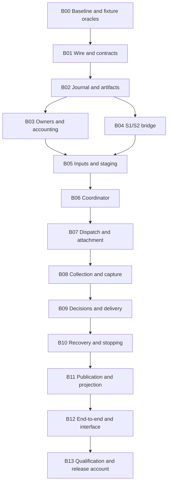

# S3 final design review and proposed implementation DAG

Tickets: DLV-08, DLV-09; related DLV-10. Date: 2026-11-03, America/Los_Angeles.
Status: final review performed; recommend the revised baseline and bundle plan for
user acceptance. FR01-FR10/new backend and bundle choices remain proposals, not
attributed user acceptance, implementation go, protocol adoption or native evidence.
No S3 runtime/test/driver implementation or new native campaign in this milestone.

## 1. Review verdict and continuity

The user affirmed the preceding [operational direction](subsystem3-operational-contract-closure-2026-11-03.md)
at de4e48114a45dff53f807d00267cb1758bbba6e6 and requested final design review and a
bundle DAG with acceptance/recovery gates. OC01-OC16 are direction-affirmed/details-
open in the methodology index; the original dated proposals and their byte hashes
remain unchanged. Final acceptance/build authorization is recorded separately.

**Recommendation: accept the architecture and the revision3 refinements below as
the implementation baseline, subject to user review.** The contract separates
preservation, scientific eligibility, readiness, owner authority, requested effects,
observed effects and evidence-backed claims. Common lifecycle/policy remains in core;
native-specific mechanics and guarantees are explicit supplied drivers/owners.

This review found three contract gaps and one fixture-evidence gap that should be
closed before implementation: explicit caller identities for admit/issue recovery;
non-byte native state sources; closing delayed acceptance after a negative lookup;
and genuine positive execution fixtures beyond the
retrospective preservation archive. The final catalog and entry/bundle gates record
their resolutions. Backend/platform/native availability is an explicit qualification
boundary, not an invented passing integration or an excuse to omit core behavior.

Review artifacts:

- [Final revision3 catalog](subsystem3-final-contract-catalog-2026-11-03.json):
  38 record kinds, 31 operation contracts, 77 family-role positions, 48 method
  signatures; closed common forms plus explicit registered native parameter formats.
- [Implementation DAG](subsystem3-implementation-dag-2026-11-03.json): 14 bundles,
  exact predecessors, owned paths, must-show lists, recovery gates and receipt rules.
- [Acceptance plan](subsystem3-acceptance-plan-2026-11-03.json): 106 planned oracle
  specifications (62 operation positive/held cases, 20 fault boundaries, 12 cross-
  capability probes, 11 baseline/wire/ledger/temporal/end-to-end/release cases and
  one interface-behavior case), plus all 16 operational and 14 earlier serialization negative specifications,
  all 48 methods and all 38 record kinds. These are not executed S3 tests.
- [Earlier complete package review](subsystem3-complete-package-review-2026-11-03.json):
  28 authored preservation packages, not runnable experiments or native evidence.
- [Methodology index](subsystem3-methodology-index-2026-11-03.json): source-linked
  directions, refinements, future bundle/gate ownership and present claim limits.

## 2. Final review findings and resolutions

| ID | Finding / recommended resolution | Alternative and cost / prevented failure |
|---|---|---|
| FR01 | plan returns an explicit staged command C; admit takes caller-persisted admission_occurrence; issue takes caller-persisted transmission_occurrence D. Persist the admission plan and stable per-owner request IDs before RPC. | Internal ID allocation is simpler, but a lost method reply can lose the correlation needed to prevent duplicate work. More explicit IDs make retries auditable. |
| FR02 | Separate state restore_source (captured payload or owner-managed native reference), actual availability, identity and observed loading. | Byte-only checkpoint availability is easier to validate, but excludes opaque remote/federated state or encourages false local snapshots. Requires loader/owner-specific evidence. |
| FR03 | command.admission retains construction-time evidence; later immutable admission assessments/group receipts and live grants establish current authority. No mutation of C/D or capability resurrection. | A mutable admission field is convenient; it erases earlier knowledge and confuses serialized permission with live authority. |
| FR04 | Intent key=D; capture key=batch_occurrence. One live forwarding permit per definitely committed D claim; negative native queries also need old acceptance paths closed or covered by valid deduplication before retry. | Treating an exception/empty listing as proof of no effect can duplicate work or lose evidence. Explicit lookup/unknown outcomes cost recovery work. |
| FR05 | Begin with a cooperative single-host SQLite rollback journal and immutable artifact store, qualified for tested process crashes only. | Append-only files need more multi-record/CAS recovery machinery; WAL gives concurrency but adds version/operating constraints. No untested power-loss/distributed guarantee. |
| FR06 | Add independent, fully specified fresh positive fixtures with real supplied synthetic S2 bindings; preserve historical archives and their gaps. | Existing preservation packages are useful but cannot establish executable admission or receiver-side recovery. More fixture work prevents raw-story validation from masquerading as orchestration. |
| FR07 | Name tests test_audit_execution_*.py and assert mandatory case discovery/execution with zero skips. | A new naming convention would be cleaner but current tests/run_tests.py collects test_audit_*.py. A targeted-only pass cannot hide missing full-suite coverage. |
| FR08 | Owner-approved native credential transport remains possible; audit serialization/logs never contain bearer values. Restricted/uncaptured raw diagnostics and derived redactions stay distinguishable. | Blanket serialization or silently replacing originals makes disclosure and integrity claims false. Requires scoped capture/projection controls. |
| FR09 | Keep S1/S2 namespace/version ownership and current reader boundaries. Return frozen S1 evidence/existing S2 receipts through exact bridges, with loss reports for richer S3 meaning. | Extending old readers implicitly is convenient but can misresolve foreign data or overstate single-action/authority guarantees. |
| FR10 | Report framework conformance, recorded parity, host matrix and actual native integration as separate qualification dimensions. | One release-green flag is simpler but converts missing data/skips/synthetic drivers into unsupported scientific/native claims. |

### Exact revision3 refinements

Coordinator.admit adds admission_occurrence:ID; Coordinator.issue adds
transmission_occurrence:ID. PreparedOperation adds command:KnownRef(effect_command).
LiveAdmission adds occurrence, immutable admission-plan reference and assessment.
ExactOwnerRequest/owner_receipt identify the admission occurrence as well as the
stable owner subject and individual request. The admission_plan grammar fixes C,
binding digest, evidence frontier, requirement context and owner request identities.

Repeating either API with an existing ID reconciles the existing plan/intent/result.
It does not allocate another D/hold. Changed bindings conflict. A new owner epoch
requires explicit current admission, and another D remains held while prior effects
are uncertain unless the exact valid native receiver contract/policy permits it.
The plan/owner grants are not recreated from serialized metadata after a crash.

Journal.prepare_issue atomically records D's intent and claims its one local
forwarding opportunity. Only the first definitely committed claim can receive a
live issuer-held OpaqueIssuePermit, bound to C/D/binding/epoch and consumed at the
guarded driver boundary. Replaying the key or querying a stored receipt returns no
new permit. Neither token field copies nor JSON can forge one. A crash after that
claim but before native send conservatively leaves possible effects; reconciliation
is needed before any separately authorized new D. This prevents repeated local
forwarding for D; it does not prove that a provider created only one job.

A negative native lookup is scoped to its cutoff. It does not prove an earlier
in-flight request cannot arrive later. Before a new potentially duplicate effect,
require actual no_late_acceptance evidence closing old acceptance paths, or a valid
native single-effect contract covering every still-eligible arrival and retention
window. An empty listing, local timeout or expired sender lease is insufficient.
The asynchronous fixture must delay the original request until after the negative
query and prove the coordinator holds it unless the receiving boundary establishes
the required closure/deduplication. Possible jobs/charges/exposure remain tracked.

StateComponent now has component, identity, restore_source, availability, loaded and
evidence. restore_source is a tagged captured_payload or native_reference. A known
snapshot reference does not establish current availability. A valid native handle
can be usable by its permitted loader without centrally captured raw bytes; that
does not establish byte-integrity or exact hidden-state continuity. S1's narrower
projection keeps missing raw state unknown/NA and records lost guarantees.

Revision3 is a new candidate: previous revision1/revision2 artifacts retain their
bytes and meanings. Native S3 decoding initially supports only the exact accepted
revision; old candidates are raw-preserved or explicitly converted into new record
identities with source pins/losses. Conversion cannot invent admission identities,
available=true, scientific bindings, source isolation or native outcomes. Existing
S1/S2 contracts and the unchanged incarnation-key encoding procedure retain their
own exact versions.

## 3. Initial supported scope and explicit withheld claims

The initial implementation is a functioning opt-in execution/collection layer,
not just schema classes or an unsupported-port skeleton. It must implement core
meaning and validation for all 31 operation contracts and supply actual local
journal, owner/ledger, coordinator, staging, bridge, capture, decision, recovery
and publication mechanics. Injected drivers remain explicit optional mechanisms.

| Qualification | Required initial capability/evidence | Limit |
|---|---|---|
| Preservation/plan | Full revision3 record/parameter/role semantics, exact pins, contexts, missingness, rejected/partial effects and scoped claims | No native authority from metadata |
| Trusted local execution | Actual supplied function/process binding with current owner grants, deterministic fixture input/output, bounded controls/evidence | No hostile-code isolation or OS-wide blindness |
| Asynchronous conformance | Independent service process persists its own jobs/receiver epochs/receipts while coordinator dies; lookup/attach and counters verified independently | A synthetic provider protocol, not integration with a real remote system |
| Interaction | Real fixture actions, pre-send choices, explicit permitted sources, one-shot/lost-ACK delivery and scoped bundle behavior | No paid model/expert/production oracle |
| Recovery | Actual fixture state capture or native handle, permitted partial/full requirements, distinct attempts, stop/settlement/closure and replay limits | No universal exact checkpoint/replay or second independent trial |
| Publication | Local immutable package identity, dependency/audience closure, reconciliation, revision CAS and scoped availability/retention operations | No site/Slack/remote publication or global erasure |
| Scientific handoff | Supplied valid synthetic S2 bindings/requests; freeze R before O, evidence/missingness returned to S2 | No S4 metrics, causal truth, paper portability or changed scoring |

The 18 axes, 28 representative cases and four combination probes of the historical
capability map are explicitly mapped in the DAG. Additional probes cover
non-tabular/generated inputs, streams/partitions, federated partial ownership,
learned domains, weighted equal-content objects, unknown-origin jobs, opaque state
and composite actions. The core must preserve them without flattening, repairing,
leaking evaluator references or silently changing conditions. Typed interpretation
and native mechanisms still require their own exact supported contracts/receipts;
no finite test set or driver list proves coverage of every future causal system.

Stronger requests on weak backends have a meaningful tested result: preserve the
account and hold the dependent effect/claim. Successful withholding is evidence of
policy behavior, not proof the missing backend capability is implemented.

### Initial storage recommendation and qualification

Use Python's sqlite3 with rollback/DELETE journaling, synchronous FULL, verified
foreign-key enforcement, explicit bounded contention and short guarded transactions.
Artifacts are written/flushed/hash-checked before one logical journal reference/
capture commit; uncommitted staged objects remain orphans, never complete roots.
Record actual SQLite/Python/OS/filesystem versions/configuration in each receipt.

This is a design choice to qualify through process-crash/concurrent cooperative-
writer tests. SQLite documents that commit guarantees depend on operating-system
and storage assumptions; that is not evidence of untested Crucis power-loss behavior.
[SQLite atomic commit](https://www.sqlite.org/atomiccommit.html).

The workspace library reports SQLite 3.50.4. SQLite's WAL documentation describes
a concurrent WAL-reset bug affecting that version range, with fixes/backports;
the initial plan uses rollback mode and does not upgrade the environment or enable
WAL. WAL would require separate version/configuration/qualification review.
[SQLite WAL](https://www.sqlite.org/wal.html).
Shared/network database files are outside the initial backend profile; SQLite's
network-filesystem caveats support keeping that scope explicit.
[SQLite network guidance](https://www.sqlite.org/useovernet.html).

## 4. Bundle DAG and sequencing

Proposed namespace: crucis_causal/execution/. No runtime directory is created now.
The JSON DAG gives the exact predecessor sets; this diagram omits redundant edges
while retaining their dependency order. This is not an instruction to spawn agents.

| Bundle | Main acceptance gate | Recovery must-show |
|---|---|---|
| B00 | Actual final acceptance/go recorded; design/fixture/oracle hashes pinned before implementation | Fixture revision creates new identity; no native dispatch |
| B01 | All38 kinds,31 operations/77 role positions/48 signatures and exact versions/limits tested; new tests actually discovered | Wrong pin/type/context/version preserves source and causes zero dependent effects |
| B02 | Actual local atomic append/revision and transaction lookup; artifact references cannot precede retained bytes | Crash/reopen before/after commit, two writers, simulated I/O/space failure; no advanced cursor |
| B03 | Actual owner dedup/revisions/live capabilities and typed ledgers, control overhead/exposure history | Lost reserve/renew/settle replies and partial owners; no native issue or double hold/charge |
| B04 | Real existing S2 metadata projection and exact S1 R/O/context bridge, truthful unknowns/losses | Missing scientific binding, identity conflict and S1 rejected-after-call cannot become no-effect |
| B05 | Admitted realization/staging, exact inputs/recipient/stability and protected diagnostic/source behavior | Interrupted transfer/source change retains disclosure/cleanup, no automatic allowance reset |
| B06 | Durable C/admission/D intent and exactly one explicitly requested forwarding under current requirements | Same-ID replay, stale head/epoch, lost caller reply and clock expiry do not create another effect |
| B07 | Actual local/service fixture submit/lookup/attach and adequate incarnation/receiver checks | Lost ACK with receiver job count1; stale epoch refused; unknown-origin observation has no fabricated A |
| B08 | Durable bounded capture and four distinct progress stages with source-aware replay | Raw-write/capture/ACK crash points and out-of-order/duplicate/gapped input retain evidence |
| B09 | Fixed pre-send information/choice, exact correlation/delivery/receipt and scoped exposure | Receiver delivery count1 after lost ACK; missing Q2 source causes no second choice/send/fallback |
| B10 | Explicit wait/reconnect/retry/restart/stop/close policy and state/overlap/settlement | New A2, actual component evidence, expired handle refusal, stop ACK≠stop, revised bills total9 |
| B11 | Exact immutable bytes, full permitted audience/dependency closure and actual revision CAS | Commit ACK loss reuses package; ABA conflict; deleted copy does not erase history/exposure |
| B12 | Four fresh positive S3 pipelines plus old preservation archives and broader probes; installed-wheel isolation | Fresh-process recovery through integrated pipeline; CLI default/help/metadata paths cause zero native/provider calls |
| B13 | All must-shows/receipts mapped; mandatory new tests zero skips/errors/failures; scoped parity/platform accounts | A failed/environment-specific gate is diagnosed, not skipped/rebaselined to green |

No bundle passes merely by adding methods or returning unsupported for its required
initial fixture mechanisms. Independent service/owner/artifact oracles verify the
meaningful positive effects. Optional real drivers/strong guarantees can remain
unsupported, with exact scope disclosed. Preserve earlier bundle claims/source hashes
when later bundles extend a driver; new configuration/code identity gets new receipts.

## 5. Concrete acceptance and recovery protocol

Each bundle must run its relevant cases, required predecessor checks and staged-tree
gate, then make a small owned-path local commit with hooks enabled. External immutable
receipts link accepted design/source/predecessor hashes, actual case IDs/results,
environment, fault scope, implementation identity, supported claim and limitation.
Local commits do not authorize push, merge, package release, Pages or announcements.

The acceptance map separates first-gate cases from later integration cases for
every method. A case owned by a future bundle never becomes an undeclared entry
dependency of an earlier method. Fixed generic oracles are reapplied to the actual
method implementation when its owner bundle is built, and integrated again where
the later pipeline adds relevant behavior.

The 20 fixed fault points cover owner/preissue/capture/delivery/stop/state-load/
publication/cleanup barriers. Use deterministic handshakes, fresh coordinator
processes and an independent persistent fixture service/oracle, not timing sleeps.
Supervisor owns both process lifetimes so coordinator death does not accidentally
kill the oracle. Windows helpers are hidden, waits bounded, cleanup limited to
verified owned test processes/paths. No production provider, secret or sealed seed.

Required independent assertions include receiver jobs/actions/charges and actual
state, exact captured bytes, source positions, owner ledger revisions and persisted
C/D/binding identities. Tests do not merely trust driver-returned status labels.
Evaluator-only oracle observations must not enter the coordinator's/native system's
permitted inputs. Trusted-process tests establish that argument/capability boundary,
not adversarial OS isolation.

Positive operation cases and held/denied counterparts are fixed for all31 operations.
The48-method map requires meaningful state/effect/claim tests, not only signature
presence. All30 earlier negative specifications have concrete bundle owners; B00
must materialize their inputs/oracles before B01 runtime validation. Every new
mandatory case must be collected/executed with no skips. Existing26 offline data/
dependency skips remain separately reported; they do not waive a new conformance gate.

Example outcomes:

- Launch accepted, reply dropped: receiver has1 job; local acceptance stays unknown
  until adequate lookup. No lookup support means bounded close with unresolved
  work/liability, never another launch justified by a request hash.
- Q1 delivered, reply dropped: original selected response survives; receipt lookup
  shows1 delivery. Q2's missing current source produces no selection/send/abstention.
- Checkpoint handle valid but raw bytes absent: native loader may establish permitted
  partial loading; byte-integrity/full RNG continuity stays withheld. Handle expiry
  before issue means0 restarts under that strict request.
- Capture bytes retained but journal reply lost: query original batch transaction;
  ACK only its established durable source position. Do not create a replacement
  capture key or claim contiguous history from the largest seen event.
- Publication committed, reply dropped: reconcile the original frozen byte digest.
  Old source cutoff remains fixed; public L output still has exactly two native
  entities and no added private S3 metadata.

## 6. Completion, compatibility and qualification gates

Offline framework completion requires all14 bundle receipts and mandatory new tests
to pass, all initial fixture mechanisms implemented, installed-package isolation,
truthful methodology/support indexes and no unexplained S1/S2/scientific source drift.
Failures remain preserved; changes rerun affected gates. No thresholds/tolerances/
scientific expected values are changed to suppress differences.

After integration, perform one relevant legacy recorded-data parity/certificate
qualification with explicit historical inputs and external outputs when available.
The historical1298 comparisons/tolerance and14 stored+14 fresh certificate meanings
remain unchanged. Absent data holds that qualification; prior receipts are not fresh
S3 results. Framework offline completion and data-backed release qualification must
be reported separately, not quietly collapsed into an all-green statement.

Cross-platform support requires actual Linux Python3.10/3.12 and Windows3.12 receipts,
including process/SQLite/artifact tests. A Windows pass cannot become a Linux pass.
Prepare the matrix during implementation; remote CI execution/publication still
needs the appropriate authorization and protected-branch workflow. Environment
failures are diagnosed without weakening tests or turning them into dependency skips.

Any named real native integration needs its exact provider/system/environment,
data, owner rights, supported guarantees and authorized campaign scope. Controlled
offline fixture conformance is neither a real-system experiment nor universal
causal-discovery/native accuracy coverage. No new paid/native/sealed campaign is
authorized by this plan or by local documentation commits.

The paper/scientific contract, B5, analysis/score/harness, research tree, tracker and
sites remain outside write scope. Do not rebuild the generic research/reviewer
workstream in Crucis. Technical methodology handoff remains accepted rule → owned
implementation → scoped receipt → supported claim/limit.

## 7. Current checks and review state

This milestone checks contract inheritance/diffs and all source pins, exact bundle
dependencies/acyclicity, operation/method/role/kind mappings, every planned fault/
negative owner, capability-axis coverage and required test-discovery prefix.
These are plan consistency checks; no S3 case, SQLite store or new native fixture
has been executed. The SQLite version observation was read-only introspection.
The ordinary staged-tree package gate is recorded separately from future S3 gates.

The external static review passed 742 correspondence/source-preservation checks:
all 28 existing implementation anchors, 10 scoped test-file anchors and one fixture
anchor remain unchanged; all 48 methods have a nonempty first-gate mapping with
no hidden future or parallel-branch dependency. These checks inspect design data
and existing sources; the 106 proposed S3 cases remain unexecuted.

The recommendation is ready for final user adjudication, not a claim that all
external mechanisms or every future scientific/native combination is already
supported. Any material acceptance change gets a new dated/pinned baseline before
building, with affected cases/gates updated explicitly; earlier receipts stay intact.

## Where we're going

Review FR01-FR10, the initial qualified scope and B00-B13 DAG together. Once the
user accepts the final baseline and explicitly authorizes implementation, record
that go and begin B00, progressing only through actual predecessor gates and small
validated local commits. S3 implementation, native campaigns and external publication
remain distinct authorizations; none begins in this design/planning milestone.
